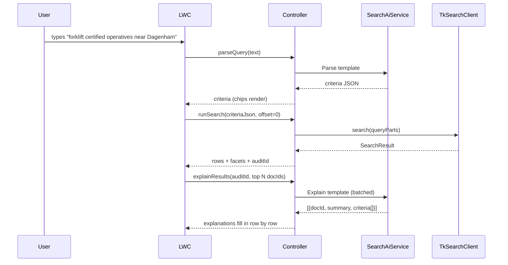
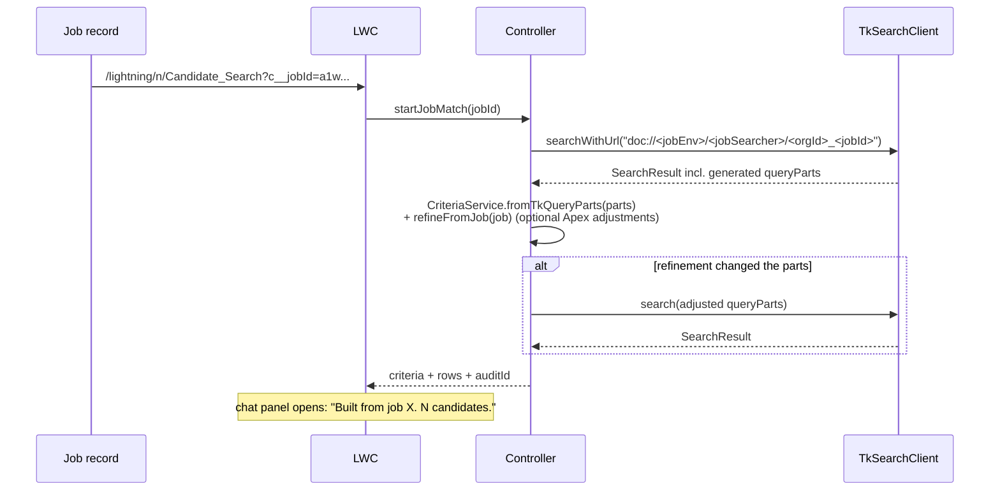
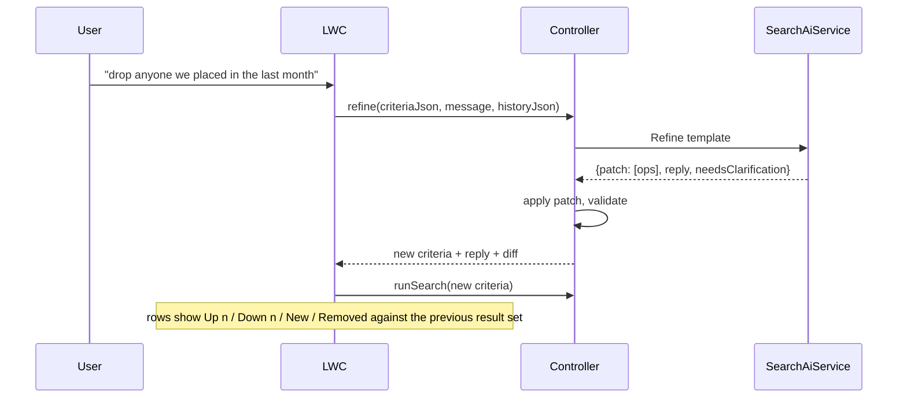
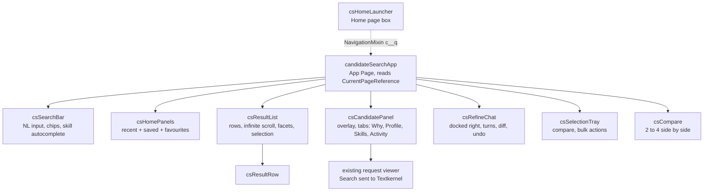

# Candidate Search: build spec (v1, pilot)

Owner: Ainsley Grover. Target: pilot deploy Friday 20 Nov 2026.
Design reference: the "Candidate Search Redesign" canvas (screens 1, 2A, 3, 4). Screen 2B (cards) is not being built, except as the narrow-screen fallback.

This spec is written to be handed to Claude Code. Read it top to bottom before writing code. Section 15 lists what is confirmed and what is still open. Section 16 is the working agreement for Claude Code (secrets, deploys, line endings). Read it before the first commit.

---

## 1. Goal and scope

Replace the classic Textkernel Portal search for a pilot customer with a native Lightning search experience:

- Natural-language search that becomes editable criteria chips, which become Textkernel (TK) query parts.
- Job match: a button on the Job opens the search pre-built from the **Textkernel-indexed job document**, then refined in Apex if needed.
- Refine by conversation: a docked chat panel that changes the criteria one message at a time, with a visible diff and undo.
- Results as rows, with a candidate panel that **overlays** the list (never squashes it), infinite scroll, facet filters, bulk actions.
- AI explanation per candidate for the first batch, grounded in what TK actually matched.
- Compare 2 to 4 candidates side by side.
- Recent searches, saved searches, favourites.
- **Audit trail** of every AI suggestion and every TK result (score and per-query-part flags per candidate), stored in custom objects.

### In v1 (Friday)
Everything above, plus: flags for candidates already on the job (applied, shortlisted, placed), facet filters, bulk add to job / add to talent pool, infinite scroll.

### Not in v1
Saved-search alerts, "more like this", thumbs feedback, outreach sending. Keep the data model ready for them (section 9) but build no UI.

---

## 2. Architecture

```mermaid
flowchart LR
    subgraph SF[Salesforce]
        BTN[Job: Match button<br/>URL button] -->|c__jobId| PAGE
        HOME[Home page<br/>mini search box] -->|c__q| PAGE
        PAGE[App Page tab<br/>candidateSearchApp LWC]
        PAGE --> CTRL[CandidateSearchController<br/>@AuraEnabled facade]
        CTRL --> CRIT[CriteriaService<br/>criteria JSON to query parts]
        CTRL --> TKS[TkSearchClient<br/>SOAP search, searchWithUrl, getMetadata]
        CTRL --> SKL[TkSkillsClient<br/>REST autocomplete]
        CTRL --> AI[SearchAiService<br/>parse, refine, explain]
        CTRL --> PIPE[PipelineStatusService<br/>applied, shortlisted, placed]
        CTRL --> AUD[SearchAuditService<br/>Queueable writer]
        CTRL --> SAVED[(Saved_Search__c)]
        AUD --> A1[(Search_Audit__c)]
        AUD --> A2[(Search_Audit_Result__c)]
    end
    TKS -->|Named Credential<br/>service account| TK[(Textkernel Search SOAP)]
    SKL -->|Named Credential<br/>Tx-AccountId + Tx-ServiceKey| TKSI[(Textkernel Tx Skills API)]
    AI --> PROV{SearchLlmProvider}
    PROV -->|default| ANT[(Anthropic Messages API)]
    PROV -.->|switchable| PT[(Einstein prompt templates)]
```

Principles:
1. **The criteria JSON is the single source of truth.** Chips, chat, saved searches, job match and the audit all read and write the same object (section 4). The natural-language text only *produces* criteria; it is never re-parsed after the first search.
2. **TK decides who matches and the score. The LLM only explains.** The explain prompt receives TK's per-query-part flags and highlights, and must not contradict them.
3. **Fast first paint.** Results render as soon as TK answers. Explanations and the audit write happen after, in separate calls.

---

## 3. Flows

### 3a. Natural-language search


### 3b. Job match (TK job document first)

- The job docID format seen in the index is `<15/18-char org Id>_<18-char record Id>`, for example `00DDp000001z8VW_a1wDp000001g5BiIAI`.
- If `searchWithUrl` fails (job not indexed, env name wrong), fall back to `CriteriaService.fromJobRecord(job)` built from `TR1__Job__c` fields, and show a notice in the chat panel saying so.
- `searchWithUrl` does not paginate. Page 2 onwards uses `search` with the returned queryParts (section 6.4).

### 3c. Refine turn (chat panel)

- Undo is client-side: the LWC keeps a stack of criteria snapshots, one per turn. Undo pops and re-runs the search.
- Questions about results ("why is Aimee third?") are answered from the current audit rows and explanations, without changing criteria (`patch` empty).

### 3d. Infinite scroll
- `runSearch(criteriaJson, offset)` with `pageSize = 20` and `resultOffset = offset`. TK caps `resultOffset + pageSize` at 10000 and caps pageSize at 100 when paging.
- An `IntersectionObserver` on a sentinel row at the bottom of the list triggers the next page. Stop when `hasMoreResults` is false.
- Only page 1 is explained by the LLM automatically. Rows from later pages get a "Explain" link that explains on demand (batched as the user clicks, or when the panel opens).
- Each page appends to the same `Search_Audit__c` (new `Search_Audit_Result__c` rows with their rank).

---

## 4. Criteria JSON contract (v1)

Used by: LWC chips, chat, Saved_Search__c.Criteria_JSON__c, Search_Audit__c.Criteria_JSON__c, all prompt templates.

```json
{
  "version": 1,
  "source": "nl",
  "naturalLanguage": "Forklift-certified warehouse operatives within 15 miles of Dagenham",
  "jobId": null,
  "tkJobDocId": null,
  "items": [
    {
      "id": "c1",
      "kind": "title",
      "label": "Warehouse Operative",
      "value": "Warehouse Operative",
      "weight": "required",
      "origin": "nl"
    },
    {
      "id": "c2",
      "kind": "certification",
      "label": "Certified Forklift Operator",
      "value": "Certified Forklift Operator",
      "code": null,
      "weight": "strongly_preferred",
      "origin": "nl"
    },
    {
      "id": "c3",
      "kind": "location",
      "label": "Dagenham + 15 mi",
      "value": "Dagenham",
      "radius": 15,
      "unit": "mi",
      "weight": "required",
      "origin": "nl"
    }
  ],
  "filters": {
    "candidate_status": ["Available"]
  },
  "exclusions": {
    "pipelineForJob": true,
    "placedWithinDays": 30
  }
}
```

Field rules:
- `kind`: `title | skill | certification | location | keyword | language | shift | availability | fingerprint | tk_raw`.
  - `fingerprint` = TK's generated `text_fingerprint` part from a job document. Shown as one chip ("Job description"), removable, not editable.
  - `tk_raw` = any generated TK part we do not map. Carried through untouched in `raw` so job-match queries are not degraded. Shown as a grey chip with the TK field name.
- `weight`: `required | strongly_preferred | preferred | excluded`. Maps to TK `condition` (section 5).
- `origin`: `nl | job | refine | user | tk_generated`. Drives the audit (which chips the AI proposed versus the user).
- `code`: TK skill code (`KS...`) when the chip came from autocomplete. Skill codes in the index (`it_skills`, `custom_text_2` on skill nested objects) use the same `KS` ids as the autocomplete `code_id`.
- `raw`: optional, the original TK QueryPart for `tk_generated` items, so an unchanged part is sent back exactly as TK produced it.
- `id`: stable per chip, generated client-side (`c` + counter) or by Apex for parsed items. Patches reference it.
- `filters`: facet field name to selected values. Sent as REQUIRED parts on that field.
- `exclusions`: `placedWithinDays` is sent to TK as an excluded part on the last-placement date field. `pipelineForJob` is applied after TK returns (section 8), because it depends on Salesforce application and shortlist records.

Validation (Apex, `CriteriaService.validate`): known kinds and weights only, max 25 items, location needs value and radius, at least one item or filter, labels trimmed to 120 chars. Reject with a readable message.

---

## 5. Criteria to TK query parts

Candidate index fields come from the Textkernel connector mapping in the test org (`Candidate.json`, package 6.45.0). Index field names below were seen in real responses; anything marked "confirm" must be checked with `getMetadata` against `tksf_bh4sf_tso_cv` before it is used.

| kind | TK field | Salesforce source (connector mapping) | Notes |
|---|---|---|---|
| title | `FULLTEXT` (quoted) in v1; move to `jobtitles` / `recent_jobtitles` once confirmed | `Contact.Title`, `TR1__EmploymentHistory__c.TR1__Title__c` | Seen in responses: `jobtitles`, `recent_jobtitles`. |
| skill | `FULLTEXT` text, plus a code part on the skills field when `code` is set | `TR1__Skills__c` (`TR1__Master_Skill_Name__c`, `TR1__Skill_Code__c`) filtered by `Is_IT_Skill__c`, `Is_Professional_Skill__c`, `Is_Competency_Skill__c` | Seen: `it_skills` (KS codes), `profskills` / `professional_skills_terms` (text). `TR1__Skill_Code__c` holds the same KS code the autocomplete returns. |
| certification | `FULLTEXT` (quoted), plus `custom_nested_object_1` name/code when confirmed | `TR1__Skills__c` filtered by `Is_Certifications_Skill__c` mapped to Custom Object 1 (`custom_text_1` = name, `custom_text_2` = KS code) | Seen in Ethan Kirby's document. Confirm the nested field query syntax. |
| location | `city` | `MailingCity`, `MailingPostalCode`, `MailingCountry` | Value `Town+radius`. Prefer a postcode when given. Ambiguous towns resolve to several countries (London did). |
| keyword | `FULLTEXT` | | |
| language | language skills field (confirm) | `TR1__Skills__c` filtered by `Is_Language_Skill__c` | |
| availability | date field mapped from `Date_Available__c` (confirm name) | `Contact.Date_Available__c` | "Available within 4 weeks" becomes a date range, not text. |
| status | `candidate_status` | `TR1__Candidate_Status__c` | Seen in responses. Used as a facet filter. |
| placed recently | `custom_date_1` | `TR1__Last_Placement_Date__c` | Seen on Ethan (`2024-02-05`). Drives `exclusions.placedWithinDays` inside TK. |
| owner | `owner_id`, `owner_name` | `OwnerId`, `TR1__Owner_Name__c` | Facet: "My candidates". |
| shift | `FULLTEXT` in v1 | none mapped | Always `preferred` unless the user says "only". |
| fingerprint, tk_raw | `raw.field` | | Sent back unchanged from `raw`. |

Notes from the mapping:
- Tasks are indexed as candidate comments (`Task.Description`), which is why enrichment notes match FULLTEXT phrases.
- The default CV comes from `TR1__ContactDocument__c` with `TR1__isDefault__c`, stored off platform.
- Job submissions (`TR1__Application_V2__c`: `TR1__Job__c`, `TR1__Stage__c`), placements (`TR1__Closing_Report__c`) and talent pools (`TR1__Call_List__c`) are also in the candidate document. They could feed facets later.

| weight | TK condition |
|---|---|
| required | `REQUIRED` |
| strongly_preferred | `STRONGLY_FAVORED` |
| preferred | `FAVORED` |
| excluded | TK's exclude condition (confirmed supported; confirm the exact enum spelling in the first Postman call) |

Request settings: `synonymExpansionMode = QUERY_AND_QUERYPARTS`, `pageSize = 20`, `resultOffset` for paging, `resultFields` = explicit list (not `*`, to keep the response small enough for the Apex heap; see section 11), facets and highlighting left on.

Reuse: `AmplifyTKMatchService` already builds the SOAP envelope, quotes terms, logs a masked request and normalises scores. Extend it rather than writing a new client: add `searchWithUrl`, `resultOffset`, `resultFields`, and return the parsed `queryPartScores` per hit.

`CriteriaService.fromTkQueryParts(parts)` maps generated parts back to chips using the reverse of the table above: `jobtitle | vacancytitle | recent_jobtitles` to title, `compskills | profskills | it_skills` to skill, `city`/location fields to location, `text_fingerprint` to fingerprint, everything else to `tk_raw`.

The job document (`tksf_bh4sf_tso_vac`) is built by the connector from `TR1__Job__c` (`Job.json` mapping): title `TR1__Job_Title__c`, description `TR1__Client_Job_Description__c`, location `TR1__City__c`, `TR1__Postal_Code__c`, `TR1__Country__c`, experience and education requirements, and job skills from `TR1__Skills__r` split by `Is_Job_IT_Skill__c`, `Is_Job_Professional_Skill__c`, `Is_Job_Competency_Skill__c`, `Is_Job_Language_Skill__c`, with certifications (`Is_Job_Certification__c`) in Custom Object 1. So skills and certifications attached to the job reach the generated query without extra work, as long as they carry `TR1__Skill_Code__c`.

`CriteriaService.refineFromJob(criteria, job)` is the Apex hook for "refine the query parts if necessary". v1 rules, each switchable in custom metadata:
- If the job has a site postcode or city and the generated parts have no location, add a required location with the configured default radius.
- Cap the number of skill parts at the configured maximum (generated job queries can be long).
- Downgrade a generated REQUIRED title to STRONGLY_FAVORED when the config flag `softJobTitle` is on (fixes the loose-synonym noise seen in the talent pool tests, for example a Mechanical Engineer passing a Warehouse Operative REQUIRED part).

---

## 6. Apex

All `@AuraEnabled` methods take and return **JSON strings** for anything that is a list or nested object. Lightning Web Security delivered lists of objects to Apex as blank objects in the enrichment work, so do not pass object lists as typed parameters.

### 6.1 `CandidateSearchController` (with sharing, facade only)
```apex
@AuraEnabled public static String parseQuery(String text);                                 // returns criteria JSON
@AuraEnabled public static String startJobMatch(Id jobId);                                 // returns SearchResponse JSON
@AuraEnabled public static String runSearch(String criteriaJson, Integer offset, Id auditId); // auditId null on page 1
@AuraEnabled public static String refine(String criteriaJson, String message, String historyJson, Id auditId);
@AuraEnabled public static String explainResults(Id auditId, String docIdsJson);           // returns explanations JSON
@AuraEnabled(cacheable=true) public static String autocompleteSkills(String prefix);       // 2+ chars, cached
@AuraEnabled public static String getRecentAndSaved();                                     // not cacheable (changes after DML)
@AuraEnabled public static Id saveSearch(String name, String criteriaJson, Boolean favourite);
@AuraEnabled public static void setFavourite(Id savedSearchId, Boolean favourite);
@AuraEnabled public static String getCompareData(String contactIdsJson, Id auditId);
@AuraEnabled public static String bulkAddToJob(Id jobId, String contactIdsJson, Id auditId);
@AuraEnabled public static String bulkAddToTalentPool(Id poolId, String contactIdsJson, Id auditId);
@AuraEnabled public static void logAction(Id auditId, String docId, String action);        // opened, shortlisted, compared, dismissed
```
`SearchResponse` JSON:
```json
{
  "auditId": "a0X...",
  "criteria": { "...": "criteria JSON" },
  "requestXml": "<masked SOAP request, for the existing request viewer>",
  "total": 9,
  "hasMore": false,
  "offset": 0,
  "facets": [{ "field": "candidate_status", "values": [{ "value": "Available", "count": 4 }] }],
  "rows": [
    {
      "docId": "00DDp000001z8VW_003Dp00000F4iL5IAJ",
      "contactId": "003Dp00000F4iL5IAJ",
      "rank": 1,
      "score": 0.98,
      "scorePct": 98,
      "queryPartFlags": [1, 1, 1, 1],
      "criteriaIds": ["c2", "c3", "c1", "c4"],
      "name": "Ethan Kirby",
      "title": "Warehouse Operative",
      "city": "London",
      "distance": null,
      "highlights": { "FULLTEXT": ["... <b>Certified Forklift Operator</b> ..."] },
      "pipeline": { "applied": false, "shortlisted": false, "placedRecently": false }
    }
  ],
  "notices": ["Built from the Textkernel job document for J-0142."]
}
```
`criteriaIds` maps each `queryPartFlags` position to the chip it came from, so the UI and the explain prompt can say which criteria were met.

### 6.2 Services
- `CriteriaService`: `validate`, `toQueryParts`, `fromTkQueryParts`, `fromJobRecord`, `refineFromJob`, `applyPatch(criteria, patchJson)`.
- `TkSearchClient` (extends or wraps `AmplifyTKMatchService`): `search`, `searchWithUrl`, `getMetadata`. Parses the response with `Dom.Document`. Returns hits with score, queryPartScores, requested fields, highlights, facets, the echoed `queryParts`.
- `TkSkillsClient`: `autocomplete(prefix, languages, limit)` against the Tx Platform v10 Skills API, `{domain}/v10/skills/v2/autocomplete`, authenticated with `Tx-AccountId` (`13430659`, stored in custom metadata, not secret) and `Tx-ServiceKey` (secret, in the External Credential). Confirm the HTTP method, request body and the regional domain with one Postman call before coding. The response should carry each skill's description, category and KS code id.
- `SearchAiService`: `parse`, `refine`, `explain` (section 7). Calls a `SearchLlmProvider` interface, never a vendor directly. Validates every output against the contract. On invalid JSON, retry once, then fail with a readable message.
- `SearchLlmProvider` (interface) with `AnthropicLlmProvider` (default) and `PromptTemplateLlmProvider` (same ConnectApi pattern as `EnrichmentSkillPromptService`). The provider is chosen in custom metadata, so prompt templates can be compared later without code changes (section 7.0).
- `PipelineStatusService`: for a job and a set of Contact Ids, return applied, shortlisted and placed-in-last-N-days flags (section 8).
- `SearchAuditService`: Queueable writer (section 9).

### 6.3 Errors
Throw `AuraHandledException` with `setMessage` so the LWC gets readable text. DML errors go through the `dmlText` helper already in `EnrichmentApplyController`. The LWC uses the improved `normalizeError` from `amplifyRecordEnrichmentPanel.js` (handles `body.message`, `pageErrors`, `fieldErrors`, arrays).

### 6.4 Paging rule
Page 1 of a job match uses `searchWithUrl`. Store the returned queryParts in the criteria (`tk_generated` items with `raw`). Page 2 onwards always uses `search` with `toQueryParts(criteria)` and `resultOffset`.

---

## 7. LLM prompts

All three return JSON only. Each output is validated in Apex against the contract before use. The prompt text lives in custom metadata (`Candidate_Search_Prompt__mdt`: `Name`, `System_Prompt__c`, `Model__c`, `Max_Tokens__c`, `Tool_Schema_JSON__c`), so it can be tuned without a deploy.

### 7.0 Provider: Anthropic API by default
- `AnthropicLlmProvider` calls `POST https://api.anthropic.com/v1/messages` through a Named Credential (`Anthropic_API`) whose External Credential adds the `x-api-key` header. Also send `anthropic-version: 2023-06-01`.
- JSON output: define one tool per prompt whose `input_schema` is the output contract, and force it with `tool_choice: {"type": "tool", "name": "<tool>"}`. Read the tool's `input` from the response. No free-text JSON parsing, no fence stripping.
- Models (set per prompt in metadata): `claude-haiku-5-5` for parse and refine (latency matters, small inputs); `claude-sonnet-5-5` for explain (quality of the reasons matters, batch of 10).
- Timeouts: 30 s for parse and refine, 60 s for explain. Log `usage.input_tokens` and `usage.output_tokens` and the duration on the audit record.
- `PromptTemplateLlmProvider` keeps the Einstein path available: same inputs, templates named as below, called through `ConnectApi.EinsteinLLM.generateMessagesForPromptTemplate`.
- Data governance: the Anthropic path sends candidate profile snippets outside the Einstein Trust Layer. Get sign-off from Bullhorn and the pilot customer before the pilot goes live, and send only the fields the explain prompt needs.

### 7.1 `CandidateSearch_Parse` (tool `set_criteria`)
Input: `NaturalLanguage` (text), `Today` (date), `DefaultRadiusMiles`.
Output: criteria JSON (section 4) with `origin: "nl"`.
Rules in the prompt:
- Job titles become `title`. "Certified", "licence", "ticket" phrases become `certification`.
- Words like "must", "only", "need" make `required`. Plain mentions make `preferred`. Certifications default to `strongly_preferred`.
- "within N miles of X" becomes a required location. No radius given means the default.
- Never invent criteria that are not in the text.

### 7.2 `CandidateSearch_Refine` (tool `update_criteria`)
Input: `CriteriaJson`, `Message`, `HistoryJson` (last 6 turns), `ResultSummaryJson` (top 10 rows with scores and flags).
Output:
```json
{
  "patch": [
    { "op": "add", "item": { "kind": "shift", "label": "Nights", "value": "nights", "weight": "preferred" } },
    { "op": "update", "id": "c3", "set": { "radius": 25, "label": "Dagenham + 25 mi" } },
    { "op": "remove", "id": "c5" },
    { "op": "setExclusion", "key": "placedWithinDays", "value": 30 }
  ],
  "reply": "Done. Nights now counts in their favour but does not exclude anyone.",
  "needsClarification": false
}
```
- Questions about the results return an empty patch and an answer in `reply`, based only on `ResultSummaryJson`.
- Ambiguous requests return `needsClarification: true` and a question in `reply`.

### 7.3 `CandidateSearch_Explain` (tool `explain_candidates`)
Input: `CriteriaJson`, `CandidatesJson`, max 10 per call:
```json
[{ "docId": "...", "score": 98, "met": ["c1","c2","c3","c4"], "notMet": [], "highlights": ["..."], "profile": { "title": "...", "skills": ["..."], "city": "...", "recentNotes": ["..."] } }]
```
Output:
```json
[{ "docId": "...", "summary": "One sentence, max 30 words.", "criteria": [{ "id": "c2", "met": true, "evidence": "short quote or field", "source": "Call transcript, 2 Nov" }] }]
```
Rules: `met`/`notMet` come from TK and are final. The summary must not claim a criterion is met when TK says it is not. Evidence is quoted from the input, never invented. If there is no evidence, say "not on record".

---

## 8. Pipeline flags and exclusions

For a job match, flag candidates already connected to the job with three SOQL queries (job Id plus the page's Contact Ids):

| Flag | Object | Fields (from the connector mapping) |
|---|---|---|
| Applied (with stage) | `TR1__Application_V2__c` | `TR1__Job__c`, `TR1__Stage__c`, candidate lookup behind the `TR1__Application1__r` relationship (confirm the field name with a describe) |
| Shortlisted | `TR1__Opportunity_Discussed__c` | `TR1__Job__c` (relationship `TR1__Opportunities_Discussed__r` from the Job), `TR1__Candidate__c` |
| Placed | `TR1__Closing_Report__c` | `TR1__Job__c`, `TR1__Person_Placed__c`, `TR1__Booking_Date__c`, `TR1__Start_Date__c` |

"Placed recently" across all jobs does not need SOQL: it is sent to TK as an excluded date range on `custom_date_1` (`TR1__Last_Placement_Date__c`), see section 5.

UI: a small tag on the row (Applied, Shortlisted, Placed 3 Nov). `exclusions.pipelineForJob = true` hides them, with a "Show 2 hidden" link in the list header.

The `pipelineForJob` exclusion is applied after TK returns, so a page can come back short. When more than half a page is hidden, fetch the next page automatically until 20 visible rows or no more results.

---

## 9. Data model

### `Saved_Search__c`
| Field | Type | Notes |
|---|---|---|
| Name | Text(80) | User's name for the search. Auto-named from the NL text for recent searches. |
| OwnerId | standard | Private OWD. |
| Criteria_JSON__c | Long Text(131072) | Criteria contract v1. |
| Natural_Language__c | Text(255) | |
| Job__c | Lookup(TR1__Job__c) | Set for job-match searches. |
| Is_Saved__c | Checkbox | False = recent (auto-logged), true = saved by the user. |
| Is_Favourite__c | Checkbox | |
| Last_Run__c | DateTime | |
| Run_Count__c | Number | |
| Alert_Enabled__c | Checkbox | Not used in v1. Ready for saved-search alerts. |

Recent searches = last 10 `Is_Saved__c = false` for the user. Prune older ones in the audit Queueable.

### `Search_Audit__c` (one per search execution, including each refine)
| Field | Type | Notes |
|---|---|---|
| Name | Auto Number `SA-{000000}` | |
| User__c | Lookup(User) | |
| Search_Type__c | Picklist | Natural language, Job match, Refine, Saved search |
| Job__c | Lookup(TR1__Job__c) | |
| Parent_Audit__c | Lookup(Search_Audit__c) | The previous search in the same session (refine chain). |
| Saved_Search__c | Lookup(Saved_Search__c) | |
| Natural_Language__c | Long Text(32768) | What the user typed or said in chat. |
| AI_Proposed_Criteria_JSON__c | Long Text(131072) | Exactly what the parse/refine prompt returned, before validation. |
| Criteria_JSON__c | Long Text(131072) | The criteria actually searched (after user edits and validation). |
| AI_Reply__c | Long Text(32768) | Chat reply shown to the user. |
| Prompt_Template__c | Text(80) | API name of the template used. |
| TK_Method__c | Picklist | search, searchWithUrl |
| TK_Request_XML__c | Long Text(131072) | Masked (no password). |
| TK_Total__c | Number | |
| TK_Duration_ms__c | Number | |
| TK_Raw_Response_File__c | Text(18) | ContentVersion Id of the full response, stored as a File when it is larger than 131072 characters. |
| Status__c | Picklist | Success, TK error, AI error |
| Error__c | Long Text(32768) | |

### `Search_Audit_Result__c` (one per candidate returned, child of the audit)
| Field | Type | Notes |
|---|---|---|
| Search_Audit__c | Master-Detail | |
| Contact__c | Lookup(Contact) | |
| TK_Doc_Id__c | Text(80) | |
| Rank__c | Number | Position across all pages. |
| Page_Offset__c | Number | |
| TK_Score__c | Number(5,4) | Raw score. |
| TK_Score_Pct__c | Percent | As displayed. |
| TK_Query_Part_Scores__c | Text(255) | For example `1,1,1,1`. |
| TK_Criteria_Map__c | Text(255) | Chip ids in the same order, for example `c2,c3,c1,c4`. |
| TK_Result_XML__c | Long Text(131072) | This candidate's `resultItems` element, trimmed to score, queryPartScores, requested fields and highlights. |
| AI_Explanation__c | Long Text(32768) | Summary shown. |
| AI_Evidence_JSON__c | Long Text(131072) | Per-criterion evidence returned by the explain prompt. |
| AI_Explained_At__c | DateTime | |
| Pipeline_Flags__c | Text(255) | Applied, Shortlisted, Placed as shown. |
| Hidden_By_Exclusion__c | Checkbox | |
| User_Action__c | Picklist (multi) | Opened, Compared, Shortlisted, Added to pool, Dismissed |
| User_Action_At__c | DateTime | Last action. |

This gives a complete record per search: what the user asked, what the AI proposed, what was actually searched, what TK returned per candidate (score and flags), what the AI said about each, and what the human did next.

### Writing the audit
- `runSearch` builds the audit records in memory and enqueues `SearchAuditWriter` (Queueable) with them. It creates the `Search_Audit__c` synchronously only to get the Id back to the LWC; children are inserted in the Queueable.
- `explainResults` and `logAction` update the result rows, keyed by `Search_Audit__c` + `TK_Doc_Id__c` (make that combination a unique text field `Audit_Doc_Key__c` for upserts).
- Never let an audit failure fail the search. Catch, log `Status__c`/`Error__c` on the parent.

### Configuration: `Candidate_Search_Config__mdt` (one record, `Default`)
TK candidate environment `tksf_bh4sf_tso_cv` and its searchEngine, TK job environment `tksf_bh4sf_tso_vac` and its searchEngine, Tx account id `13430659`, LLM provider (`Anthropic` or `PromptTemplate`), Named Credential names, page size (20), explain batch size (10), default radius (15 mi), max skill parts (8), `softJobTitle` flag, recent searches kept (10), autocomplete languages (`en`, add `fr` for Adecco France).

---

## 10. LWC component tree



State lives in `candidateSearchApp`: `criteria`, `criteriaHistory` (undo stack), `auditId`, `rows`, `offset`, `hasMore`, `selection` (max 4 for compare), `panelDocId`, `chatTurns`. Children receive data by `@api` and raise events (`criteriachange`, `loadmore`, `rowopen`, `selectionchange`, `refine`).

Behaviour notes:
- **Candidate panel overlays the list** (absolute, right, width min(500px, 100%)). Escape closes it. Up and down arrows move to the previous or next row while it is open.
- **Chat panel is docked** and narrows the list. When both are open, the candidate panel overlays the list area to the left of the chat.
- **Row change tags** after a refine: compare the new rank to the previous result set by docId (Up n, Down n, New, Removed). Removed rows show for one render in a collapsed "1 removed" line.
- **Explanations** show a shimmer placeholder until `explainResults` returns.
- **Below 900px**, rows render as cards (screen 2B layout), and panels become full-screen sheets.
- **Job Id handoff**: `@wire(CurrentPageReference)` reads `state.c__jobId` and `state.c__q`. Re-run when they change, so a second Match click from another job works without a reload.
- Accessibility: real buttons and inputs, `aria-label` on icon buttons, keyboard reachable chips, focus moves into the panel when it opens and back to the row when it closes.

Entry points:
- **Job button**: URL detail page button on `TR1__Job__c`, `/lightning/n/Candidate_Search?c__jobId={!TR1__Job__c.Id}`. No code.
- **Home page**: `csHomeLauncher` on the Home Lightning page, navigates with `standard__navItemPage` and `state: { c__q: text }`.

---

## 11. Limits and performance

- Sync Apex heap is 6 MB. The full `resultFields=*` response for 9 candidates was about 1.9 MB of XML, and `Dom.Document` roughly multiplies that. Request an explicit field list, `pageSize = 20`, and trim each `resultItems` before storing.
- Callout timeout: set 30 s for TK, 60 s for the explain prompt. One TK callout and at most one LLM call per Apex transaction.
- Do the prompt call and the TK callout in **separate** `@AuraEnabled` calls (parse, then search; search, then explain), so each fits limits and the UI can render in between.
- `autocompleteSkills`: debounce 250 ms in the LWC, minimum 2 characters, `cacheable=true`. The Skills API rate limit is about 1000 requests per minute on a standard plan and 30 per minute on demo plans, so the debounce matters on the pilot.
- No `cacheable=true` on anything that reads data changed by DML in the same session (recent and saved searches, compare data after actions).

---

## 12. Security

- Service account for the pilot: TK environment name and password in a **Named Credential with an External Credential** (custom principal). The SOAP body uses merge fields (`{!$Credential.<ExternalCredential>.Password}`) with "Allow formulas in HTTP body" enabled, so the password never sits in code or custom metadata.
- Skills API: `Tx-ServiceKey` in its own External Credential. The account id is not secret and lives in custom metadata.
- Anthropic API key in its own External Credential (`x-api-key`).
- **No password, key or token is ever committed to the repo**, including test classes and Postman exports. Section 16.
- The request viewer and `TK_Request_XML__c` always show the masked request (existing masking in `AmplifyTKMatchService`).
- Classes are `with sharing`. Audit objects: users can read their own; a permission set `Candidate_Search_Audit_Admin` can read all.
- Prompt inputs contain candidate data. With the Anthropic provider this data leaves Salesforce, so the pilot needs sign-off (section 7.0). Send only the fields the explain prompt needs.

---

## 13. Build order and acceptance

**Wednesday: back end**
1. Custom objects, fields, custom metadata, Named Credentials, permission sets.
2. `TkSearchClient`: `search` with paging and explicit fields, `searchWithUrl`, response parsing with queryPartScores. Test in anonymous Apex against Ethan Kirby's search from the talent pool work.
3. `CriteriaService` with unit tests for `toQueryParts`, `fromTkQueryParts`, `applyPatch`, `validate`.
4. `SearchLlmProvider`, `AnthropicLlmProvider`, the three prompts in custom metadata, then `SearchAiService`. The prompt-template provider can follow later.
5. `SearchAuditWriter`, `PipelineStatusService`.

Done when: anonymous Apex can run NL text to criteria to TK results, write an audit with one result row per candidate, and explain the top 10.

**Thursday: front end**
6. `candidateSearchApp`, `csSearchBar` (chips, autocomplete), `csResultList` with infinite scroll and facets.
7. `csCandidatePanel` overlay, `csRefineChat`, `csSelectionTray`, `csCompare`, `csHomePanels`, `csHomeLauncher`.
8. Job button and App Page tab.

Done when: the four canvas screens work end to end on the demo org, including Match from a job.

**Friday morning: pilot hardening**
9. Run against the pilot customer's data and jobs. Check ambiguous locations, empty results, TK errors, prompt failures (each shows a readable message and the search still works without AI).
10. Apex test coverage above 75% with `HttpCalloutMock` for TK, the Skills API and the Anthropic API.
11. Deploy, assign permission sets, add the button to the Job layout, add the launcher to the Home page.

---

## 14. Reuse from earlier work

- `AmplifyTKMatchService.cls`: envelope building, `quoteTerm`, `normaliseScore`, masked request logging, `describeQuery`.
- `AmplifyTalentPoolMatchController.cls`: PoolBrief pattern (good model for `fromJobRecord`), favoured skills logic, `requestXml` for the viewer.
- `callListMatchViewer` / `talentPool` LWC: request viewer (`prettyXmlLines`, `.req-*` CSS), retrieval trace and evidence features.
- `EnrichmentSkillPromptService.cls`: ConnectApi prompt call pattern (for `PromptTemplateLlmProvider`).
- `amplifyRecordEnrichmentPanel.js`: `normalizeError`, `runStep` console logging, JSON-string parameters to Apex.
- `EnrichmentApplyController.cls`: `dmlText`, `System.JSON` usage, describe-driven field handling.

Lessons already learned in this project:
- Pass lists of objects to Apex as JSON strings, not typed parameters.
- Never name a variable `json` in Apex. Use `System.JSON` explicitly.
- `Task.WhatId` cannot be a Contact.
- Location in TK comes from the Contact address on re-index. A wrong address silently drops candidates out of a REQUIRED location part.
- Quoted FULLTEXT phrases match enrichment notes indexed as comments.

---

## 15. Confirmed and still open

Confirmed (17 Nov):
- Candidate environment `tksf_bh4sf_tso_cv`, job environment `tksf_bh4sf_tso_vac`, both through the pilot service account.
- `searchWithUrl` returns the generated query parts.
- TK supports excluding query parts.
- Skills API uses the Tx service account (`Tx-AccountId` 13430659 plus a service key).
- Connector field mappings for candidates and jobs (`Candidate.json`, `Job.json`), reflected in sections 5 and 8.
- LLM: Anthropic API by default behind a provider interface. Prompt templates stay switchable.
- `useNlqs` is not used in v1.

Still open (check in this order, Wednesday morning):

| # | Question | How to check |
|---|---|---|
| 1 | The searchEngine names in both environments, for the `doc://` URL | `getMetadata` on each environment, then `searchWithUrl("doc://tksf_bh4sf_tso_vac/<searcher>/00DDp000001z8VW_a1wDp000001g5BiIAI")` in Postman. |
| 2 | Exact spelling of the exclude condition | One Postman search with an excluded part. |
| 3 | Queryable field names: job titles, availability date, language skills, `custom_nested_object_1` sub-fields | `getMetadata` on `tksf_bh4sf_tso_cv`. Update section 5. |
| 4 | Skills API method, body and regional domain | One Postman call to `/v10/skills/v2/autocomplete` with the Tx headers. |
| 5 | Candidate lookup field on `TR1__Application_V2__c` | Describe in the org. |
| 6 | Explain batch size within the 60 s timeout | Time 10 candidates on `claude-sonnet-5-5`. Drop to 5 per call if slow. |
| 7 | Data sign-off for sending candidate data to the Anthropic API | Bullhorn and the pilot customer. |

References:
- [Search Service operations (search, searchWithUrl, getMetadata)](https://developer.textkernel.com/SearchMatch/master/Web%20Services%20API/Search%20Service/)
- [Match queries and the doc:// URI format](https://developer.textkernel.com/SearchMatch/master/Query%20Language/Match%20Queries/)
- [Matching introduction](https://developer.textkernel.com/SearchMatch/master/Matching/Introduction/)
- [SearchRequest fields (resultOffset, pageSize, hiddenQueryParts)](https://developer.textkernel.com/SearchMatch/master/Object%20Structures/Search%20Request/)
- [Tx Platform v10 Skills Intelligence endpoint mapping (autocomplete)](https://developer.textkernel.com/tx-platform/v10/skills-intelligence/tk-mappings/)

---

## 16. Working agreement for Claude Code

- The repo is an SFDX project (`force-app/main/default`). Claude Code writes code and tests, commits to a feature branch and opens pull requests. Ainsley deploys to the org from his laptop with the `sf` CLI. Claude Code does not deploy.
- No secrets in the repo. Passwords, service keys and API keys live only in Named Credentials and External Credentials in the org. Use placeholders such as `<SET IN EXTERNAL CREDENTIAL>` in any sample or README.
- Ainsley works on Windows and his files are CRLF. Add a `.gitattributes` with `*.cls text eol=crlf`, `*.js text eol=crlf`, `*.html text eol=crlf`, `*.xml text eol=crlf`, `*.css text eol=crlf`, and do not reformat files that are not part of the change.
- Every new class has a test class with `HttpCalloutMock`s. Do not call real TK or Anthropic endpoints from tests.
- Keep `@AuraEnabled` parameters as JSON strings for anything that is a list or object (section 6).
- Each pull request lists which acceptance item in section 13 it delivers and anything it could not verify without the org.
